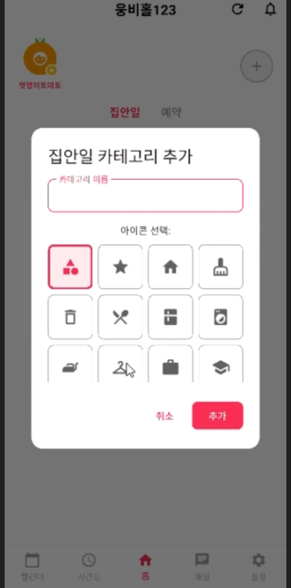
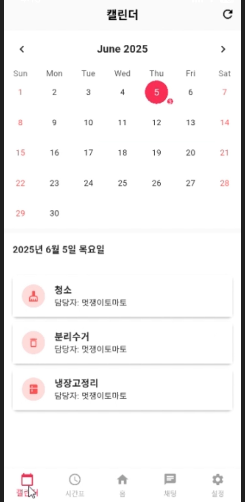
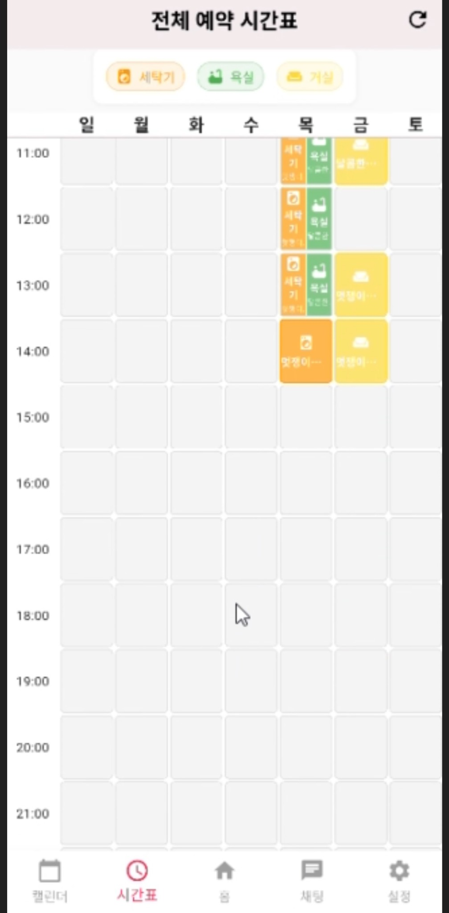
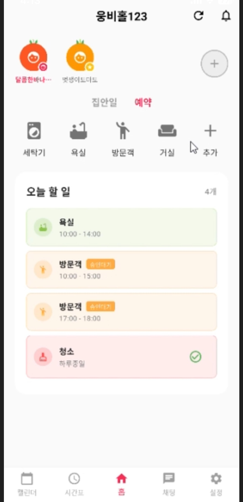

<div align="center">

# 🍅 방토리 | Bangtory

### 함께하는 공간이 즐거워지는 시간

**룸메이트와 함께하는 일상을 더 편리하고 조화롭게 관리하는 공동생활 플랫폼**

`Flutter` · `Node.js` · `Express.js` · `MongoDB` · `Socket.IO`

[🎬 시연 영상](https://youtu.be/0KnfuD7JgWM) · [📂 GitHub 저장소](https://github.com/broccoli-cake/bangtory)

</div>

---

## 📌 프로젝트 소개

**방토리**는 기숙사·쉐어하우스 등 공동생활 공간에서 발생하는 일정 충돌, 집안일 분담, 공용 시설 예약 및 소통 문제를 하나의 앱에서 관리하도록 돕는 **룸메이트 라이프스타일 관리 서비스**입니다.

각자의 생활 패턴을 존중하면서도 함께 사용하는 공간과 해야 할 일을 쉽게 확인할 수 있도록 설계했습니다.

### 해결하고자 하는 문제

- **집안일 분담의 불명확함**: 누가 언제 무엇을 해야 하는지 확인하기 어려움
- **공용 공간 이용 시간 충돌**: 세탁기·욕실·거실 등 시설 사용 일정이 겹침
- **흩어진 일정 정보**: 공동생활에 필요한 일정을 한곳에서 파악하기 어려움
- **소통의 번거로움**: 공지나 요청을 매번 별도로 전달해야 함

## ✨ 주요 기능

| 기능 | 설명 |
| --- | --- |
| 🏠 **홈 대시보드** | 함께 생활하는 구성원과 오늘 할 일을 한눈에 확인 |
| 🧹 **집안일 관리** | 집안일 카테고리를 생성하고 담당 업무를 구분하여 관리 |
| 📅 **공유 캘린더** | 날짜별 공동 일정을 확인하고 집안일 계획을 파악 |
| ⏰ **공용 시설 예약** | 세탁기·욕실·거실 등의 이용 시간을 시간표로 확인 |
| 💬 **소통 기능** | 룸메이트 간 정보 공유 및 커뮤니케이션을 지원하는 화면 구성 |

## 📱 구현 화면

실제 앱에서 구현한 주요 화면입니다.

| 시작 화면 | 집안일 카테고리 | 공유 캘린더 |
| :---: | :---: | :---: |
|  |  |  |

| 예약 시간표 | 홈 대시보드 |
| :---: | :---: |
|  |  |


## 🛠 기술 스택

| 구분 | 기술 | 역할 |
| --- | --- | --- |
| Frontend | Flutter / Dart | 모바일 UI 및 사용자 인터랙션 |
| Backend | Node.js / Express.js | REST API 및 서버 로직 |
| Realtime | Socket.IO | 실시간 채팅 및 변경 알림 |
| Database | MongoDB | 공동생활 관련 데이터 저장 및 관리 |
| Version Control | Git / GitHub | 소스 코드 및 협업 이력 관리 |


## 📁 프로젝트 구조

GitHub 저장소 최상위 디렉터리 기준입니다.

```text
bangtory/
├── frontend/        # Flutter 클라이언트
├── backend/         # Node.js 서버
└── README.md        # 프로젝트 안내
```


## 📚 프로젝트 문서

| 문서 | 내용 |
| --- | --- |
| 📄 [유스케이스 명세서](docs/documents/%EB%B0%A9%ED%86%A0%EB%A6%AC_%EC%9C%A0%EC%8A%A4%EC%BC%80%EC%9D%B4%EC%8A%A4%EB%AA%85%EC%84%B8%EC%84%9C.pdf) | 사용자·방 관리부터 예약, 알림, 채팅까지 72개 유스케이스 |
| 📄 [기술 사양 문서](docs/documents/%EB%B0%A9%ED%86%A0%EB%A6%AC_%EA%B8%B0%EC%88%A0%EC%82%AC%EC%96%91%EB%AC%B8%EC%84%9C.pdf) | 시스템 아키텍처와 프론트엔드·백엔드 기술 설계 |
| 📄 [API 테스트 케이스](docs/documents/%EB%B0%A9%ED%86%A0%EB%A6%AC_API%ED%85%8C%EC%8A%A4%ED%8A%B8%EC%BC%80%EC%9D%B4%EC%8A%A4.pdf) | 사용자·방·집안일·예약·채팅·알림 API의 43개 테스트 케이스 |
| 📄 [화면 구현 문서](docs/documents/%EB%B0%A9%ED%86%A0%EB%A6%AC_%ED%99%94%EB%A9%B4%EA%B5%AC%ED%98%84.pdf) | 앱 주요 화면과 관련 유스케이스 및 화면별 설명 |
| 📄 [프로젝트 발표자료](docs/documents/%EB%B0%A9%ED%86%A0%EB%A6%AC_%EB%B0%9C%ED%91%9C%EC%9E%90%EB%A3%8C.pdf) | 기획 배경, 주요 기능, UI, 기술 및 구현 과정 |
| 📄 [프로젝트 결과 보고서](docs/documents/%EB%B0%A9%ED%86%A0%EB%A6%AC_%ED%94%84%EB%A1%9C%EC%A0%9D%ED%8A%B8%20%EA%B2%B0%EA%B3%BC%20%EB%B3%B4%EA%B3%A0%EC%84%9C.pdf) | 개발 배경, 요구사항, 설계, 구현 및 기대효과 |


## 🎯 기대효과

- **생활 관리 효율 향상:** 집안일과 일정을 한곳에서 관리하여 확인 비용 감소
- **공용 공간 충돌 완화:** 예약 현황을 시각적으로 제공하여 중복 이용 방지에 도움
- **공정한 역할 분담:** 해야 할 일과 담당자를 명확히 표시
- **원활한 공동생활:** 공유 정보의 접근성을 높여 룸메이트 간 소통 지원

## 👥 팀원 소개

| 이름 | 담당 |
| --- | --- |
| 최현경 | Backend 개발 |
| 민수연 | Backend 개발 |
| 김민영 | Frontend 개발 |
| 홍수한 | Frontend 개발 |

## 🎬 시연 영상

[](https://youtu.be/0KnfuD7JgWM)


## 🖼️ 전시 포스터

[방토리 포스터](docs/documents/방토리_전시포스터.pdf) |


---

<div align="center">

**🍅 함께 사는 일상을 더 편리하게, 방토리**

</div>
